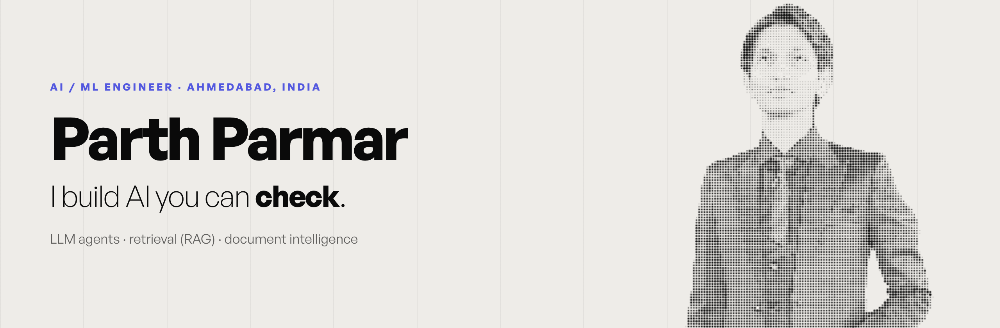
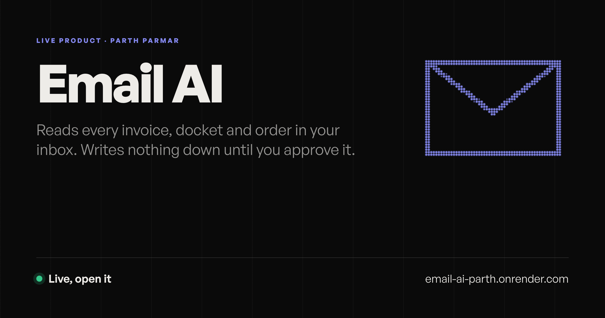
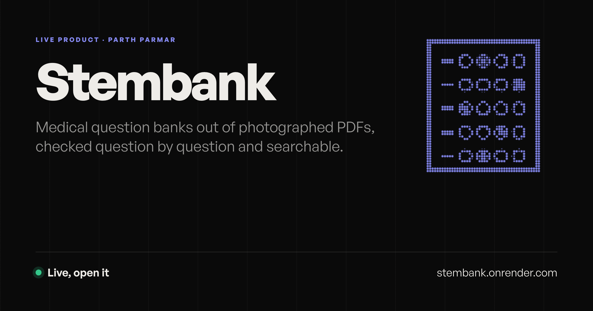
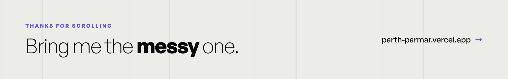

<a href="https://parth-parmar.vercel.app">
  <picture>
    <source media="(prefers-color-scheme: dark)" srcset="assets/hero-dark.png">
    
  </picture>
</a>

### Hey, I'm Parth 👋

AI/ML engineer at EncodeDots in Ahmedabad, India. I build LLM agents, retrieval assistants and document pipelines that hold up in production, with the evals, guardrails and cost control that keep them honest. Two of them are products you can open right now.

[](https://parth-parmar.vercel.app)
[](https://email-ai-parth.onrender.com/)
[](https://stembank.onrender.com/)
[](https://www.linkedin.com/in/parth-parmar-7168ab191)

## Things I'm building

<table>
  <tr>
    <td width="50%" valign="top">
      <a href="https://email-ai-parth.onrender.com/"></a>
      <h3><a href="https://email-ai-parth.onrender.com/">Email AI</a></h3>
      Reads invoices, dockets and orders straight from Gmail with read-only access, extracts the fields in one model call, and saves nothing until a person approves it against the page.
      <br><br>
      <a href="https://parth-parmar.vercel.app/work/email-ai">Case study</a> · first load takes about a minute (free tier)
    </td>
    <td width="50%" valign="top">
      <a href="https://stembank.onrender.com/"></a>
      <h3><a href="https://stembank.onrender.com/">Stembank</a></h3>
      Turns photographed medical question banks into searchable questions. Any question whose answer key names an option that is not on the page is dropped, not stored.
      <br><br>
      <a href="https://parth-parmar.vercel.app/work/stembank">Case study</a> · first load takes about half a minute (free tier)
    </td>
  </tr>
</table>

## `~/.config/parth.json`

```json
{
  "name": "Parth Parmar",
  "role": "AI/ML Engineer at EncodeDots",
  "location": "Ahmedabad, India",
  "builds": "AI you can check",
  "focus": ["LLM agents", "RAG", "document intelligence"],
  "shipped": "15+ production systems",
  "live": ["Email AI", "Stembank"],
  "open_to": "new projects"
}
```

<sub>Most of my work lives in private client repos. The twelve case studies, with a replay of each one working, are at [parth-parmar.vercel.app/work](https://parth-parmar.vercel.app/work).</sub>

## Toolbox

<a href="https://parth-parmar.vercel.app/services">
  
</a>

## Snack time

A snake eats my contribution graph every day. Most of the food is in private repos, so some days it goes hungry.

<picture>
  <source media="(prefers-color-scheme: dark)" srcset="https://raw.githubusercontent.com/parthparmar0816/parthparmar0816/output/snake-dark.svg">
  
</picture>

<br><br>

<a href="https://parth-parmar.vercel.app">
  <picture>
    <source media="(prefers-color-scheme: dark)" srcset="assets/foot-dark.png">
    
  </picture>
</a>
